<!-- Cards in assets/ are generated by scripts/render.py. Edit copy in scripts/karachi/content.py, not the SVGs. -->

<p align="center">
  <picture><source media="(prefers-reduced-motion: reduce)" srcset="assets/static/hero.svg"></picture>
</p>

<p align="center">
  <a href="https://www.linkedin.com/in/bashair-yaqoob/"></a><a href="https://bashairyaqoob.vercel.app"></a><a href="mailto:bashairyaqoob@gmail.com"></a><a href="https://github.com/BashairYaqoob?tab=repositories"></a>
</p>

<br>

<picture>
  <source media="(prefers-color-scheme: dark)" srcset="assets/sections/who-dark.svg">
  
</picture>

I'm Bashair, a Computer Science student at **FAST NUCES** in Karachi. I build software on top of language models: retrieval pipelines that answer from real documents, agents that plan and call tools, and voice systems that hold a conversation in real time.

The projects I enjoy most push an LLM to be accountable. An interviewer whose questions are grounded in a candidate's actual code. Six agents arguing over a document until its blind spots show. Underneath the model I care about the plain engineering, too: typed state, tests, clean APIs, and full-stack interfaces people can actually use.

Away from the editor I help run student tech communities:

- **Co-Head, EM Competitions** · ACM
- **Co-Head, EM Operations** · GitHub Campus Club
- **Module Co-Head, AI & Data Science** · PROCOM

<br>

<picture>
  <source media="(prefers-color-scheme: dark)" srcset="assets/sections/arsenal-dark.svg">
  
</picture>

<p align="center">
  <picture><source media="(prefers-reduced-motion: reduce)" srcset="assets/static/arsenal.svg"></picture>
</p>

<br>

<picture>
  <source media="(prefers-color-scheme: dark)" srcset="assets/sections/work-dark.svg">
  
</picture>

<p align="center">
  <a href="https://github.com/BashairYaqoob/AI-Video-Interviewer"><picture><source media="(prefers-reduced-motion: reduce)" srcset="assets/static/projects/ai-video-interviewer.svg"></picture></a>
  <a href="https://github.com/shahirahere5/Blindspot-AI"><picture><source media="(prefers-reduced-motion: reduce)" srcset="assets/static/projects/blindspot-ai.svg"></picture></a>
  <a href="https://github.com/BashairYaqoob/Whatsapp-Langchain-Bot"><picture><source media="(prefers-reduced-motion: reduce)" srcset="assets/static/projects/whatsapp-rag-bot.svg"></picture></a>
  <a href="https://github.com/BashairYaqoob/Lead-Generation-Agent"><picture><source media="(prefers-reduced-motion: reduce)" srcset="assets/static/projects/lead-generation-agent.svg"></picture></a>
</p>

<p align="center"><sub>
  also shipped&nbsp;
  <a href="https://ehsanx.com">EhsanX</a>, a production site for a leadership consultancy ·
  <a href="https://github.com/BashairYaqoob/CarWash_Voice_Agent">Car Wash Voice Agent</a>, Vapi + FastAPI booking ·
  <a href="https://github.com/BashairYaqoob/AI-Project---MindHaven">MindHaven</a>, a mental-health journal with an AI chatbot ·
  <a href="https://wandererfolk.lovable.app/">Wanderfolk</a>, an AI travel planner ·
  <a href="https://github.com/BashairYaqoob/Smart-Study-Schedule-Optimizer">Study Schedule Optimizer</a>, topological sort in C++
</sub></p>

<br>

<picture>
  <source media="(prefers-color-scheme: dark)" srcset="assets/sections/city-dark.svg">
  
</picture>

<p align="center">
  <picture><source media="(prefers-reduced-motion: reduce)" srcset="assets/static/city.svg"></picture>
</p>

<p align="center"><sub>Karachi is called the City of Lights. This skyline is redrawn every night from my contribution calendar: one building per week, oldest on the left; seven floors, one per day; a window lights up when I committed that day. Mazar-e-Quaid, Frere Hall and Empress Market stand in the haze behind.</sub></p>

<br>

<picture>
  <source media="(prefers-color-scheme: dark)" srcset="assets/sections/now-dark.svg">
  
</picture>

```text
building    AI Video Interviewer → guardrails, scorecard, MCP server
learning    agentic AI → LangChain, LangGraph, multimodal RAG
updating    my 3D portfolio → bashairyaqoob.vercel.app
```

<br>

<picture>
  <source media="(prefers-color-scheme: dark)" srcset="assets/sections/connect-dark.svg">
  
</picture>

Working on something with language models, agents or retrieval? I'd like to hear about it. Reach me on [LinkedIn](https://www.linkedin.com/in/bashair-yaqoob/), at [bashairyaqoob@gmail.com](mailto:bashairyaqoob@gmail.com) or [bashairyaqoob05@gmail.com](mailto:bashairyaqoob05@gmail.com), or through [my portfolio](https://bashairyaqoob.vercel.app).

<p align="center">
  
</p>
